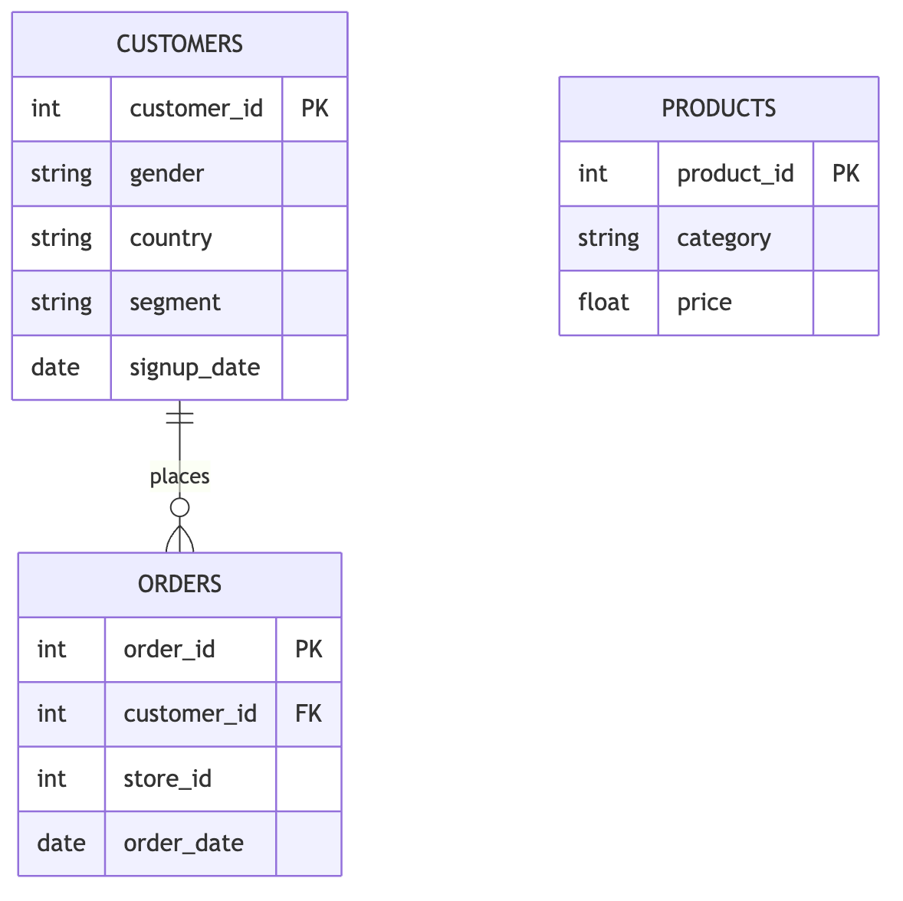
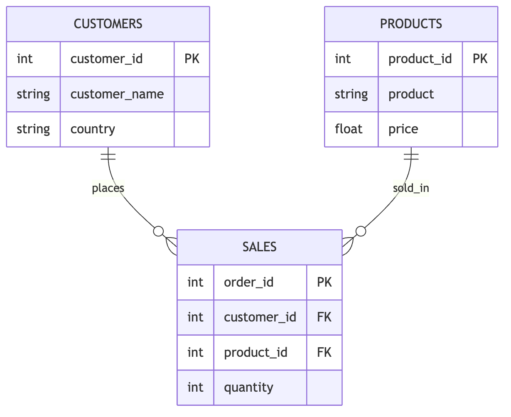
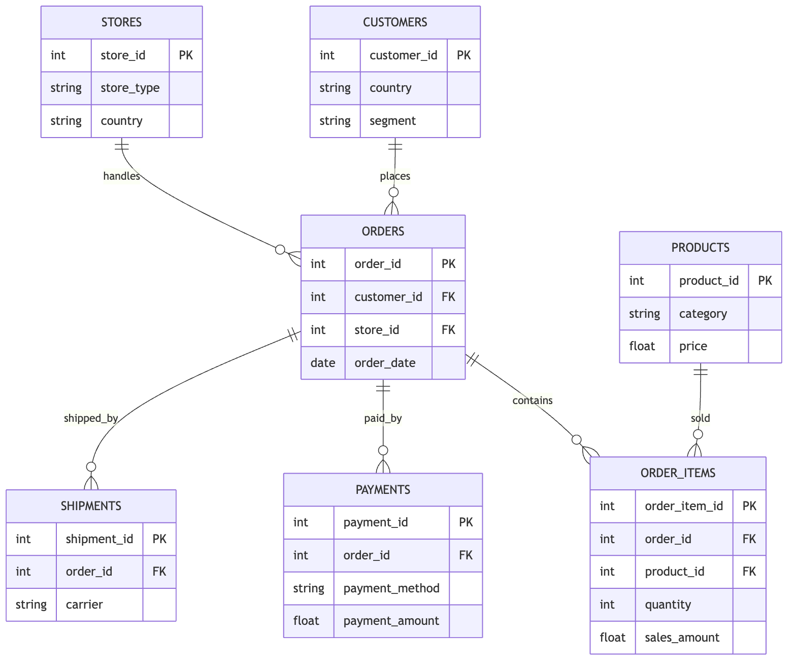

# Beautiful ER Diagrams for Weeks 2–3

These diagrams visually reinforce the database structure students use across the course.

---

# Session 3 — Relational Foundations



**Teaching emphasis:**  
Students see how `customer_id` connects customer records to orders.

---

# Session 3 — Example Query

```sql
SELECT c.country, COUNT(o.order_id) AS total_orders
FROM customers c
JOIN orders o
  ON c.customer_id = o.customer_id
GROUP BY c.country;
```

**Business question:**  
Which countries generate the most orders?

---

# Session 4 — Transaction Analytics



**Teaching emphasis:**  
`sales` links customers and products directly, so the focus is the
`JOIN ... ON` condition: a wrong join key silently returns garbage
matches — not an error.

In Session 4, the shared retail database splits a sale into the richer `orders` / `order_items` tables.

---

# Session 4 — Example Query

```sql
SELECT p.product,
       SUM(s.quantity * p.price) AS revenue
FROM sales s
JOIN products p
  ON s.product_id = p.product_id
GROUP BY p.product
ORDER BY revenue DESC;
```

**Business question:**  
Which products generate the most revenue?

---

# Week 3 — Full Operational Database



**Teaching emphasis:**  
Students now see a realistic business schema used for operations, finance, and logistics.

---

# Week 3 — Example Queries

Revenue by store type:

```sql
SELECT s.store_type, SUM(oi.sales_amount) AS revenue
FROM stores s
JOIN orders o ON s.store_id = o.store_id
JOIN order_items oi ON o.order_id = oi.order_id
GROUP BY s.store_type;
```

Payment method usage:

```sql
SELECT payment_method, COUNT(*) AS num_payments
FROM payments
GROUP BY payment_method;
```

---

# Why These Diagrams Matter

These visuals help students connect:

- primary keys
- foreign keys
- relationships
- business meaning
- SQL query design

They make the schema feel like a **business system**, not just a collection of tables.
